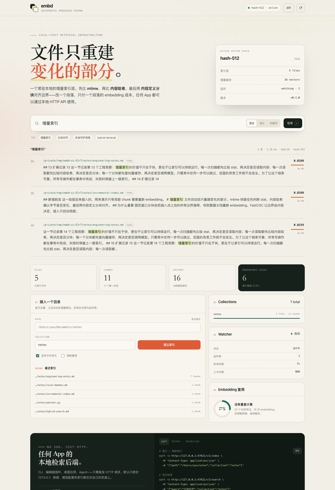

# embd

[](https://www.python.org/)
[](LICENSE)
[](https://sqlite.org/fts5.html)
[](#开发与测试)
[](#设计取舍与限制)

> 文件改动后，只重建变化的部分。
>
> **Status:** v0.1.0 · pre-1.0 · Python 3.10+ · macOS / Linux

一个常驻本地的**增量 embedding 索引层**：文件变了以后，如何只重算真正变化的 chunk，并把结果通过一个稳定的本地 API 交给任何 App。



在仓库根目录：

```bash
python3 -m pip install -e .
embd serve --open
# http://127.0.0.1:47821
```

不想安装也可以直接运行：

```bash
python3 -m embd serve --open
```

> GitHub 网页上传可能丢失可执行位；文档默认使用 `python3 -m embd`，不依赖 `+x`。

## 目录

- [它到底做了什么](#它到底做了什么)
- [快速开始](#快速开始)
- [给任何 App 用](#给任何-app-用)
- [架构](#架构)
- [配置](#配置)
- [支持的文件类型](#支持的文件类型)
- [数据与备份](#数据与备份)
- [开发与测试](#开发与测试)
- [参与贡献](#参与贡献)
- [设计取舍与限制](#设计取舍与限制)
- [License](#license)

---

## 它到底做了什么

大多数 RAG 索引器的流程是：扫描目录 → 固定窗口切块 → 对每个块调用 embedding → 写入向量库。文件改一个字，整篇文档的所有窗口都会移位，于是整篇重新 embedding。

embd 把失效判断拆成三层，越便宜越先做：

| 层级 | 判断 | 命中时 |
|---|---|---|
| 1. stat | `mtime_ns + size + inode` 没变 | 连文件都不打开 |
| 2. 内容 | 原始字节的 SHA-256 没变 | 只更新 stat，不分块、不 embed |
| 3. 分块 | 每个 chunk 文本的 SHA-256 已在缓存 | 直接复用已有向量 |

第 3 层能成立，是因为分块边界不是固定偏移，而是由内容决定的：

- **FastCDC / gear hash** 在字节流上选切点，并吸附到附近的段落、换行或句号；
- 插入一段文字只会扰动切点附近的 chunk，后续边界会重新对齐；
- 每个 chunk 以自身文本的 SHA-256 为身份，相同段落可以跨文件、跨版本复用向量；
- embedding 调用**先完成**，再在一个事务里原子替换文件的分块；模型服务挂了，旧索引仍然可用。

内置 benchmark 会验证这件事（60 篇文档，编辑 12 篇）：

```text
$ python3 -m embd bench

documents            60 (edited 12)
initial chunks       272
initial embeddings   272
after edits          45 chunks written, 12 embeddings recomputed
chunks reused        260 (95.6%)
embedding reduction  95.6%
search hit rate      100.0%
elapsed              309 ms
```

编辑了 12 篇文档，只有 12 个 chunk 需要新的 embedding，而不是 272 个。改动越局部，省得越多。

---

## 快速开始

### 环境

- Python **3.10+**
- 运行时依赖只有 [numpy](https://numpy.org/)；HTTP、SQLite、CLI、Web 控制台全部使用标准库
- macOS / Linux；Windows 理论可用（未验证）
- 不需要 Docker、Node、Postgres 或外部向量数据库

### 直接运行（不安装）

```bash
python3 -m embd doctor          # 环境自检
python3 -m embd serve --open    # 启动 daemon + 控制台
```

等价于：

```bash
PYTHONPATH=. python3 -m embd serve --open
```

### 安装成命令

```bash
python3 -m pip install -e .
embd serve
```

### 索引第一个目录

```bash
embd index ~/Documents/notes --collection notes
embd search "分块对齐" --collection notes
embd stats
```

`index` 默认会把目录注册为 watch root，daemon 启动后每 5 秒做一次 stat 扫描，自动刷新变化的文件。`--no-watch` 只索引一次。

其他常用命令：

```bash
embd files -c notes                 # 已索引文件
embd collections                    # 所有 collection
embd reindex -c notes               # 强制重读（仍会复用向量缓存）
embd reindex -c notes --force-embed # 丢掉这个 collection 的向量后重算
embd remove ~/notes/old.md -c notes # 只从索引移除，不删磁盘文件
embd gc                             # 清理没有 chunk 引用的向量
embd bench -n 60                    # 增量基准
```

---

## 给任何 App 用

daemon 只暴露普通 HTTP JSON，没有 SDK 绑定。默认监听 `127.0.0.1:47821`。

### 建立 / 刷新索引

```bash
curl -s http://127.0.0.1:47821/v1/index \
  -H 'Content-Type: application/json' \
  -d '{"path":"/Users/you/notes","collection":"notes"}'
```

大目录可以异步执行：

```bash
curl -s http://127.0.0.1:47821/v1/index \
  -H 'Content-Type: application/json' \
  -d '{"path":"/Users/you/notes","collection":"notes","async":true}'
# {"ok":true,"job_id":"...","status":"running"}

curl -s http://127.0.0.1:47821/v1/jobs/<job_id>
```

### 检索

```bash
curl -s http://127.0.0.1:47821/v1/search \
  -H 'Content-Type: application/json' \
  -d '{"query":"增量索引","collection":"notes","limit":5}'
```

返回结构（节选）：

```json
{
  "ok": true,
  "query": "增量索引",
  "mode": "hybrid",
  "count": 3,
  "took_ms": 1.16,
  "model": "hash-512",
  "results": [
    {
      "path": "/Users/you/notes/incremental-index.md",
      "collection": "notes",
      "ordinal": 0,
      "start": 0,
      "end": 212,
      "score": 0.026,
      "vector_score": 0.179,
      "lexical_rank": 4,
      "content_hash": "…",
      "snippet": "…",
      "text": "完整 chunk 原文"
    }
  ]
}
```

- `mode`: `hybrid`（默认）/ `vector` / `lexical`
- `path_prefix`: 只搜某个目录
- `score`: RRF 融合分，不是余弦相似度；跨检索器只比较排序
- `start/end`: chunk 在**提取后文本**的 UTF-8 字节流中的偏移，方便上层做引用（HTML/Office/PDF 会先抽取文本）
- 每个文件默认最多返回 2 个 chunk（`search.max_per_path`），避免长文档挤掉其他结果

### Python（无第三方依赖）

```python
import json
import urllib.request

BASE = "http://127.0.0.1:47821"

def post(path, payload):
    req = urllib.request.Request(
        BASE + path,
        data=json.dumps(payload).encode(),
        headers={"Content-Type": "application/json"},
        method="POST",
    )
    with urllib.request.urlopen(req) as response:
        return json.load(response)

post("/v1/index", {"path": "/Users/you/notes", "collection": "notes"})
result = post("/v1/search", {"query": "分块对齐", "collection": "notes"})
for hit in result["results"]:
    print(hit["score"], hit["path"])
    print(hit["snippet"])
```

完整示例见 [`examples/python_client.py`](examples/python_client.py)。

### JavaScript

```js
const { results } = await fetch("http://127.0.0.1:47821/v1/search", {
  method: "POST",
  headers: { "Content-Type": "application/json" },
  body: JSON.stringify({ query: "分块对齐", collection: "notes" }),
}).then((r) => r.json());
```

### 主要接口

| Method | Path | 说明 |
|---|---|---|
| `GET` | `/health` | 存活、版本、模型；无需 API key |
| `GET` | `/v1/stats` | 文件、chunk、向量、复用、watcher 状态 |
| `GET` | `/v1/config` | 公开配置（不含密钥） |
| `GET` | `/v1/collections` | collection 列表 |
| `POST` | `/v1/collections` | 创建空 collection |
| `DELETE` | `/v1/collections/{name}` | 删除 collection 及其索引 |
| `POST` | `/v1/index` | 索引文件/目录；支持 `async` |
| `POST` | `/v1/search` | 混合 / 向量 / 关键词检索 |
| `GET` | `/v1/search?q=…` | 查询串便捷入口 |
| `GET` | `/v1/files` | 已索引文件 |
| `DELETE` | `/v1/files` | 从索引移除路径 |
| `POST` | `/v1/reindex` | 重建 collection；`force_embed` 清向量 |
| `GET/POST/DELETE` | `/v1/watch` | 查看 / 添加 / 移除 watch root |
| `POST` | `/v1/gc` | 清理孤立向量 |
| `GET` | `/v1/jobs` | 最近任务 |
| `GET` | `/v1/jobs/{id}` | 任务状态与进度 |
| `GET` | `/` | 本地控制台 |

错误统一返回：

```json
{"ok": false, "error": {"code": "invalid_path", "message": "path or paths is required"}}
```

如果配置了 `api_key`，除 `/health` 外的 `/v1/*` 需要：

```
X-API-Key: <key>
# 或
Authorization: Bearer <key>
```

---

## 架构

```text
                    ┌────────────────────────────┐
  CLI / 编辑器插件 /  │  embd serve                │
  桌面 App / Agent ──►│  ThreadingHTTPServer       │
                    │  /v1/index /v1/search …    │
                    └──────────────┬─────────────┘
                                   │
              ┌────────────────────┼────────────────────┐
              ▼                    ▼                    ▼
         Indexer              Searcher              Watcher
     stat → hash → chunk    vector + FTS5 RRF     poll + stat
              │                    │                    │
              └────────────┬───────┴────────────────────┘
                           ▼
                  SQLite（WAL，单文件）
      files / chunks / chunks_fts / embeddings / watch_roots
```

### 索引流程

```text
scan
 │
 ├─ stat 命中 ──────────────────────────────► skip（不读文件）
 │
 ├─ 读字节 → SHA-256 命中 ──────────────────► touch metadata
 │
 ├─ 提取文本（txt/md/code/html/docx/pptx/xlsx/ipynb/pdf*）
 │
 ├─ CDC 分块 + 边界吸附
 │
 ├─ 每个 chunk SHA-256
 │    ├─ 缓存命中 ────────────────────────► 复用向量
 │    └─ 未命中 → 批量 embedding → 写缓存
 │
 └─ 事务：删除旧 chunk → 插入新 chunk → 更新 file → FTS 触发器
```

`embedding` 永远是先算完再换索引。网络失败、模型 500、维度不匹配，都会把文件标记为 `error`，但不会破坏上一版可检索的分块。

### 为什么是 FastCDC

固定窗口的问题不是“切得不好看”，而是**边界会传播**：

```text
原文：  [ A ][ B ][ C ][ D ]
开头插入一行：
新文：  [ ? ][ ? ][ A ][ B ][ C ][ D ]   ← 所有窗口都换了
```

CDC 让切点只依赖切点附近的内容：

```text
原文：  [ A ][ B ][ C ][ D ]
插入：  [ A ][ B ][ ? ][ C ][ D ]        ← 只有 ? 附近重建
```

实现上使用固定 gear 表 + 64 位滚动哈希，在 `min/avg/max` 约束内寻找切点，然后把切点向最近的 `\n\n`、`\n`、`。`、`. ` 吸附（`chunk.snap_bytes`），避免把句子拦腰截断。切点会回退到 UTF-8 字符边界。

### 检索融合

- **向量召回**：SQLite 中的 float32 向量按需加载成 numpy 矩阵，内存缓存随数据库 `generation` 失效；余弦相似度即点积。
- **关键词召回**：FTS5 `trigram` tokenizer，对中文、代码、URL 都做子串匹配（不是只支持空格分词的 `unicode61`）。
- **融合**：Reciprocal Rank Fusion，`score = w_vec/(60+rank_vec) + w_kw/(60+rank_kw)`，避免直接比较两种不可比的原始分数。
- 同一文件默认最多 2 个 chunk；短查询（<3 字符）自动回退到 `LIKE`。

---

## 配置

默认路径：`~/.embd/config.json`（不存在也能运行）。也可以用 `EMBD_HOME`、`EMBD_CONFIG` 改变位置。

```json
{
  "host": "127.0.0.1",
  "port": 47821,
  "api_key": null,
  "embedder": {
    "provider": "hash",
    "model": "hash-512",
    "dim": 512,
    "batch_size": 32
  },
  "chunk": {
    "min_bytes": 384,
    "avg_bytes": 1200,
    "max_bytes": 4800,
    "snap_bytes": 320
  },
  "index": {
    "max_file_bytes": 2097152,
    "max_files": 200000
  },
  "watch": {
    "enabled": true,
    "interval_seconds": 5
  },
  "search": {
    "default_limit": 10,
    "min_vector_score": 0.12,
    "max_per_path": 2,
    "vector_weight": 0.65,
    "lexical_weight": 0.35
  }
}
```

环境变量覆盖：`EMBD_HOME`、`EMBD_HOST`、`EMBD_PORT`、`EMBD_API_KEY`、`EMBD_PROVIDER`、`EMBD_MODEL`、`EMBD_DIM`、`EMBD_BASE_URL`、`EMBD_BATCH_SIZE`、`EMBD_URL`（CLI 默认 remote）。

### 使用真实 embedding 模型

默认的 `hash-512` 是零配置的**词法哈希基线**：快、离线、可复现，但不是神经语义模型。要真正的语义检索，接 Ollama 或任意 OpenAI 兼容接口。

**Ollama**

```bash
ollama pull nomic-embed-text
```

```json
{
  "embedder": {
    "provider": "ollama",
    "model": "nomic-embed-text",
    "dim": 768,
    "base_url": "http://127.0.0.1:11434"
  }
}
```

**OpenAI / OpenAI-compatible**

```json
{
  "embedder": {
    "provider": "openai",
    "model": "text-embedding-3-small",
    "dim": 1536,
    "base_url": "https://api.openai.com/v1",
    "api_key_env": "OPENAI_API_KEY"
  }
}
```

```bash
export OPENAI_API_KEY=sk-...
embd serve
```

切换模型时，向量空间指纹 `provider:model:dim:v1` 会变。旧向量不会被删除：`embd reindex -c <collection>` 后用新模型补算，切回旧模型可以直接复用。控制台会提示 `needs_reindex`。

> `dim` 必须与模型实际输出一致；不一致时 daemon 会报清晰错误，而不是存下错误维度的向量。Ollama 常见维度：`nomic-embed-text` 768、`mxbai-embed-large` 1024、`bge-m3` 1024。

---

## 支持的文件类型

- 纯文本 / Markdown / reStructuredText / Org
- 代码与配置：Python、JS/TS、Go、Rust、Java、Kotlin、Swift、C/C++、C#、PHP、Ruby、Shell、SQL、JSON、YAML、TOML、XML 等
- HTML（去脚本/样式）、`.ipynb`
- Office（标准库 ZIP+XML）：`.docx`、`.pptx`、`.xlsx`
- PDF：可选依赖 `pip install pypdf`；未安装时会明确跳过而不是写入乱码
- 目录扫描会跳过 `.git`、`node_modules`、`venv`、`dist`、`build`、二进制、超大文件；支持根目录 `.embdignore`（每行一个 glob）

## 数据与备份

- 默认数据目录：`~/.embd/`
- 单文件数据库：`~/.embd/index.db`（WAL 模式，另有 `-wal`/`-shm`）
- 备份：停止 daemon 后复制整个 `~/.embd/`，或在线执行 `sqlite3 index.db ".backup ..."`
- 换机器：带上 `index.db` 和相同模型配置；不同 `EMBD_HOME` 用 `--home` 指定
- 重置：停止 daemon，删除 `~/.embd/index.db*`

## 开发与测试

```bash
python3 -m unittest discover -v
# 58 个测试，覆盖分块对齐、三级增量、FTS 删除、模型切换、API、鉴权、远程 embedder

python3 scripts/preflight.py   # 版本、密钥、个人路径、构建垃圾检查
embd bench -n 60
bash scripts/demo.sh
```

CI 在 `.github/workflows/ci.yml` 中跑 Ubuntu / macOS × Python 3.10–3.12，并在干净 venv 里安装 wheel 做 smoke test；打 `v*` tag 会触发 `.github/workflows/release.yml` 构建 sdist/wheel 和 GitHub Release。

项目结构：

```text
embd/
  chunker.py      FastCDC + 分隔符吸附 + UTF-8 安全切点
  embedders.py    hash / Ollama / OpenAI-compatible
  extract.py      txt、代码、HTML、docx、pptx、xlsx、ipynb、pdf
  db.py           SQLite schema、FTS5、向量缓存、WAL 事务
  indexer.py      三级失效、批量 embedding、原子换索引、watcher 扫描
  search.py       向量 + FTS5 + RRF，内存矩阵按 generation 失效
  watcher.py      轮询监听
  server.py       HTTP API、异步任务、鉴权
  cli.py          命令行
  static/         零构建 Web 控制台
tests/            58 个 unittest
```

---

## 参与贡献

- 开发环境、测试约定、增加文件格式 / embedding provider 的步骤见 [CONTRIBUTING.md](CONTRIBUTING.md)。
- 安全问题请走私密渠道，不要开公开 issue，见 [SECURITY.md](SECURITY.md)。
- 行为准则见 [CODE_OF_CONDUCT.md](CODE_OF_CONDUCT.md)。
- 版本记录见 [CHANGELOG.md](CHANGELOG.md)；维护者发布流程见 [RELEASING.md](RELEASING.md)。

这个项目优先保持“单文件 SQLite + 本地 HTTP”的形态。新增运行时依赖前请先开 issue 讨论。

---

## 设计取舍与限制

- **mtime 快路径是启发式**：理论上存在“内容变了但 mtime 和 size 都没变”的情况（例如某些同步工具刻意保留时间戳）。日常编辑、`git checkout`、保存文件都会更新 mtime；需要绝对正确时用 `embd reindex --force` 或定期深检。
- **轮询而非 FSEvents/inotify**：换来跨平台零依赖。5 秒间隔下，stat 扫描通常远低于磁盘 I/O 瓶颈；超大目录可调 `watch.interval_seconds` 或 `--no-watch` 后由外部触发。
- **hash-512 不是语义模型**：它提供可用的离线基线（中文 uni/bi/tri-gram + 英文词/子词），但近义改写需要真实 embedding。默认阈值 `min_vector_score=0.12` 是针对哈希碰撞噪声的；换神经模型后可以调低。
- **单机单守护进程**：SQLite WAL 允许 CLI 与 daemon 并发，但没有多写者协调协议。多个 daemon 指向同一个 DB 不推荐。
- **删除与被监听的父目录**：从索引里删掉一个文件后，如果它的父目录仍在 watch root 中，下一轮扫描会重新加入。要永久排除，先 `DELETE /v1/watch` 移除父目录，或使用 `.embdignore`。
- **不做 OCR / 音视频 / 网页抓取**：这一层只负责“文本文件 → 可检索 chunk”，上层应用可以自己把网页/音频转成文本文件再交给它。
- **远程 embedding 的隐私边界**：使用 OpenAI 等远程 provider 时，chunk 文本会发送到对应服务；本地 Ollama / hash 不离开机器。
- **默认只绑定 localhost**：需要局域网访问时显式设置 `host: 0.0.0.0` 并配置 `api_key`。这不是一个多租户服务。

## License

MIT。见 [LICENSE](LICENSE)。
